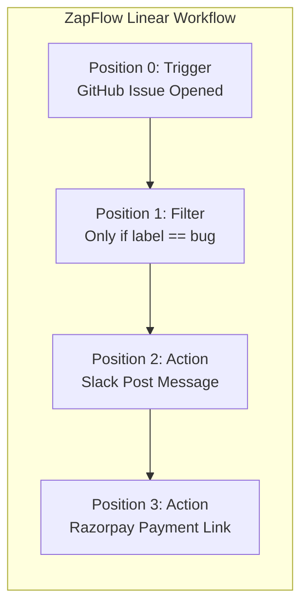

# Chapter 1 — Philosophy, Core Concepts & The Webhook Problem

> **ZapFlow Builder's Manual & Architecture Journey**  
> *Chapter 1 of 10*

---

## 1.1 What Zapier Actually Is at Its Core

At its most fundamental level, workflow automation platforms like Zapier or ZapFlow can be distilled into a single imperative sentence:

$$\text{\bf "When X happens, do Y."}$$

Every feature that Zapier has ever shipped—from complex multi-step pipelines and branch filters to authentication credential vaults and execution history—exists solely to make that single sentence programmable and dependable for someone who does not write code.

However, beneath this deceptively simple mental model lies a profound distributed systems problem:

```
┌─────────────────────────────────┐               ┌─────────────────────────────────┐
│     System X (e.g., GitHub)     │               │      System Y (e.g., Slack)     │
│  - Lives on GitHub servers      │               │  - Lives on Slack servers       │
│  - Knows nothing about Slack    │               │  - Knows nothing about GitHub   │
│  - Speaks GitHub webhook JSON   │               │  - Speaks Slack Web API JSON    │
└────────────────┬────────────────┘               └────────────────▲────────────────┘
                 │                                                 │
                 │  Event Delivery                                 │  Action Request
                 ▼                                                 │
        ┌──────────────────────────────────────────────────────────────────┐
        │                        ZAPFLOW ENGINE                            │
        │  1. Receive event from X without dropping it                     │
        │  2. Authenticate and verify origin authenticity                  │
        │  3. Translate disparate payloads across schemas                  │
        │  4. Securely sign and dispatch request to Y                      │
        │  5. Guarantee at-least-once execution with zero duplicates       │
        └──────────────────────────────────────────────────────────────────┘
```

**System X and System Y live in completely different companies, on completely separate physical infrastructures, and have never heard of each other.** 
- GitHub has no idea Slack exists.
- Razorpay has no idea Notion exists.
- Slack has no reason to learn GitHub's webhook schema.

ZapFlow sits in the middle as an **authoritative, resilient, protocol-translating intermediary**.

### The Core Three-Part Primitive

A workflow reduced to its bare skeleton consists of three primitives:

1. **The Trigger ($X$):** An external or internal state change occurring in a third-party service (e.g., *a new issue was opened in a repository*, *a payment was captured*, *a form was submitted*).
2. **The Payload ($\mathcal{P}$):** The data structure capturing the exact context of the event at the moment it transpired (e.g., issue ID, author username, payment amount, currency, customer email).
3. **The Action ($Y$):** A deterministic side-effect executed against another third-party API using parameterized data extracted or transformed from the payload (e.g., `POST https://slack.com/api/chat.postMessage`).

$$\text{Workflow Execution} = f(\text{Trigger Payload}) \longrightarrow \text{Step}_1 \longrightarrow \text{Step}_2 \longrightarrow \dots \longrightarrow \text{Step}_N$$

---

## 1.2 The First Design Dilemma: Polling vs. Webhooks

Before writing a single line of backend code, an architecture must answer a fundamental question: **How do we learn that event $X$ occurred in the first place?**

Third-party providers will not magically tap our server on the shoulder unless an agreed communication pattern is established. There are two competing paradigms:

### Option A: The Polling Paradigm

In a polling model, ZapFlow acts as an active requester. On a periodic schedule (e.g., every 60 seconds), a scheduler triggers a process to query the provider's API:
*"Has anything new happened since timestamp $T_{last}$?"*

#### The Hidden Architectural Costs of Polling:
1. **The 99% Waste Problem:** If a user configures a zap for "New GitHub Issue" on a repository that receives 2 issues per week, a 1-minute poller executes:
   $$\frac{60 \text{ checks}}{\text{hour}} \times 24 \text{ hours} \times 7 \text{ days} = 10,080 \text{ HTTP requests per week}$$
   $10,078$ of those requests return empty collections (`HTTP 200 []`). This represents catastrophic compute, network bandwidth, and database cursor update waste.
2. **Rate Limit Exhaustion:** Third-party APIs enforce strict per-token or per-IP rate limits (e.g., GitHub's 5,000 requests/hour). A system polling 50 active zaps every minute consumes:
   $$50 \times 60 = 3,000 \text{ requests/hour}$$
   This exhausts 60% of the account's total API capacity before a single user action is performed!
3. **Stateful Cursor Persistence:** Polling mandates persistent cursors (e.g., `last_seen_id`, `updated_at_checkpoint`, or `ETag`). If the worker crashes mid-sweep, cursor advancement fails, causing duplicate detections or missed events upon restart.
4. **Latency Floor:** Events are only discovered at the sampling frequency. An event occurring at $T+1\text{s}$ with a 5-minute polling interval sits completely idle for 4 minutes and 59 seconds.

### Option B: The Webhook Paradigm (Push Architecture)

In a webhook model, ZapFlow remains completely passive until the event occurs. We expose a public HTTPS endpoint (`/hooks/:zapId/:stepId`) and register it with the external provider. When an event happens, the provider's server initiates an HTTP `POST` directly to our ingress gateway.

| Dimension | Polling Architecture | Webhook Push Architecture |
| :--- | :--- | :--- |
| **Idle Resource Consumption** | Continuous API calls, network traffic, CPU scheduling | Zero resource usage when idle |
| **Event-to-Trigger Latency** | $\frac{\text{Interval}}{2}$ average (up to full interval) | Near instantaneous (sub-second HTTP dispatch) |
| **Third-Party Rate Limits** | Rapidly consumed by empty checks | Unconsumed (provider calls our server) |
| **Ingress Load Pattern** | Predictable, smoothed polling sweeps | Highly bursty, spiky, unpredictable |
| **State Tracking** | Requires persistent cursor / checkpoint per Zap | Stateless at point of ingress |

**The Decision for ZapFlow:**  
ZapFlow was deliberately built from the ground up on a **pure Webhook-driven push architecture**. It minimizes external rate-limit pressure, guarantees sub-second event ingestion, and allows zero-cost scaling when workflows are idle.

---

## 1.3 The Fallacy of the Naive Webhook Handler

Many prototype automation platforms begin with a naive Express controller:

```typescript
// ❌ THE NAIVE ANTI-PATTERN (DO NOT DO THIS)
app.post('/hooks/:zapId', async (req, res) => {
  const zap = await db.zaps.findUnique(req.params.zapId);
  const slackToken = await db.tokens.find(zap.userId);
  
  // 1. Calling external API directly inside HTTP request!
  const slackResult = await fetch('https://slack.com/api/chat.postMessage', {
    method: 'POST',
    headers: { Authorization: `Bearer ${slackToken}` },
    body: JSON.stringify({ channel: zap.config.channel, text: req.body.text })
  });

  // 2. Waiting for downstream response before acknowledging upstream!
  await db.runs.create({ zapId: zap.id, status: 'completed' });
  res.status(200).json({ ok: true });
});
```

### Why Naive Webhook Handlers Collapse in Production:

1. **Upstream Timeout Death Spirals:**  
   Most webhook dispatchers (Stripe, GitHub, Shopify, Razorpay) enforce strict connection timeouts—typically **5 to 10 seconds**. If Slack takes 6 seconds to respond, or if ZapFlow's database experiences a connection pool delay, our HTTP connection to GitHub times out. GitHub interprets this as a delivery failure and enqueues a retry. When the retry arrives 30 seconds later, it spawns *another* duplicate Slack message!
2. **The Thunder Herd Problem (Black Friday Scenario):**  
   If an e-commerce customer runs a flash sale generating 2,000 orders per second, naive ingress routes 2,000 concurrent database queries and 2,000 concurrent outbound HTTP calls. The Node.js event loop blocks, memory usage skyrockets due to in-flight buffers, connection pools exhaust, and the server crashes with `ECONNRESET`.
3. **No Failure Decoupling:**  
   If Slack is suffering a 15-minute global outage, the naive handler fails all incoming GitHub webhooks. When GitHub exhausts its retry policy, those customer events are lost permanently.
4. **Vulnerability to Timing & Spoofing Attacks:**  
   Without cryptographic HMAC verification prior to body parsing, malicious actors can flood `/hooks/:zapId` with arbitrary JSON payloads, triggering unauthorized actions and generating phantom billing charges.

---

## 1.4 The Ingestion Mandate: The 5 Golden Rules of Webhook Ingestion

To solve these systemic distributed systems challenges, ZapFlow enforces five architectural laws for its ingestion tier:

```
┌────────────────────────────────────────────────────────────────────────┐
│                        THE 5 INGESTION LAWS                            │
├────────────────────────────────────────────────────────────────────────┤
│ 1. Raw Bytes First: Never parse JSON before cryptographic HMAC verify. │
│ 2. Constant Time: Never compare auth tokens with standard string `==`. │
│ 3. Instant Ack: Ingest, persist, acknowledge in < 50ms. Never wait for  │
│    workflow actions to complete before returning HTTP 200.             │
│ 4. Transactional Outbox: Never split DB write and message queue dispatch│
│    into non-atomic separate operations (No Dual-Write!).               │
│ 5. Idempotent Ingress: Deduplicate identical delivery attempts at DB   │
│    boundary using natural provider event IDs.                          │
└────────────────────────────────────────────────────────────────────────┘
```

These principles govern the separation of `apps/hooks-api`, `apps/relay`, and `apps/worker`, which we will analyze in subsequent chapters.

---

## 1.5 Workflow Structure: Linear vs. DAG vs. State Machines

Workflow engines generally fall into three architectural categories:

1. **Directed Acyclic Graphs (DAGs):** Workflows like Airflow or Prefect where tasks branch into arbitrary parallel forks, join at synchronization barriers, and execute according to topological dependencies.
2. **State Machines:** Systems like AWS Step Functions or Temporal where workflows maintain complex event loops, wait for arbitrary signals, and branch on dynamic expressions.
3. **Strict Linear Pipelines:** Pipelines like Zapier (standard plan) or ZapFlow where a workflow is an ordered sequence of discrete steps:
   $$\text{Position } 0 \longrightarrow \text{Position } 1 \longrightarrow \text{Position } 2 \longrightarrow \dots \longrightarrow \text{Position } N$$



### Why ZapFlow Chose a Strict Linear Pipeline:

1. **Intuitive Mental Model:** End users understand sequential step-by-step causality: *"Take the email from step 0, check if amount > 100 in step 1, notify team in step 2."*
2. **Resumption Simplicity:** If a linear pipeline fails at Position 2 due to an expired OAuth token, the engine only needs to record the progress checkpoint ($Position = 1\text{ completed}$). When resumed, it simply continues at $Position = 2$. There are no complex multi-branch split-and-join synchronization barriers to recover.
3. **Deterministic Output Context Accumulation:**  
   Each step $k$ writes its output to a scoped context key:
   $$\text{Context} = \{\text{step\_1}: \mathcal{O}_1, \dots, \text{step\_k}: \mathcal{O}_k\}$$
   Step $k+1$ can unambiguously reference any previous step via template syntax:
   `{{step_1.payload.customer.email}}`.
4. **Early Exit Without Overhead:** A filter step is simply a step that evaluates a boolean condition against the accumulated context. If false, it gracefully transitions the run state to `filtered` and halts execution immediately without spawning sub-graphs.

In the next chapter, we inspect how this linear execution model maps to our multi-service monorepo architecture and end-to-end data pipeline.
