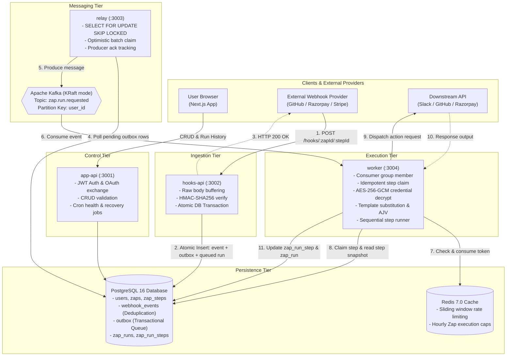
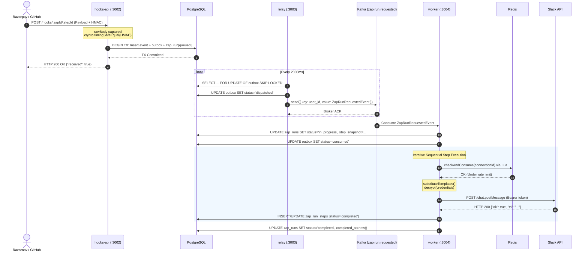

# Chapter 2 — High-Level Architecture & End-to-End Data Flow

> **ZapFlow Builder's Manual & Architecture Journey**  
> *Chapter 2 of 10*

---

## 2.1 Monorepo Topography & Service Boundaries

ZapFlow is engineered as a hardened, poly-service monorepo managed via `pnpm` workspaces and Turborepo. It separates public ingest surfaces from administrative API endpoints, background poller daemons, and asynchronous execution engines.

```
My_zappy/
├── apps/
│   ├── web/           # Next.js 14 Frontend UI (Port 3000)
│   ├── app-api/       # REST Management API & Cron Jobs (Port 3001)
│   ├── hooks-api/     # Ultra-lightweight Webhook Ingress (Port 3002)
│   ├── relay/         # Transactional Outbox Poller → Kafka Producer (Port 3003)
│   └── worker/        # Kafka Consumer & Step Execution Engine (Port 3004)
├── packages/
│   ├── db/            # Prisma Schema, Migrations, Seed & Shared Client
│   └── types/         # Canonical Kafka Event Contracts & Connector Interfaces
├── docker-compose.yml # Local Infrastructure (Postgres 16, Redis 7, Kafka KRaft)
└── Makefile           # Orchestration Commands (infra-up, dev, test, migrate)
```

### The 5 Services and Their Operational Characteristics

| Service | Port | Primary Responsibility | Compute & Scaling Profile | Failure Domain |
| :--- | :--- | :--- | :--- | :--- |
| **`web`** | `3000` | Next.js App Router UI, dashboard, Zap editor, execution timeline. | Stateless, Edge/Serverless (Vercel). | UI downtime does not affect workflow execution. |
| **`app-api`** | `3001` | User authentication, CRUD for Zaps/Steps/Connections, OAuth handshake, background maintenance cron jobs. | CPU/IO balanced. Scales with active user traffic. | Failure disables configuration, but in-flight webhook executions continue unaffected. |
| **`hooks-api`** | `3002` | High-throughput webhook ingress. Captures raw body, validates HMAC, writes to DB outbox. | High I/O, ultra-low latency (<20ms response time). Horizontal stateless scaling. | Isolated completely from Kafka, external APIs, and user session auth. |
| **`relay`** | `3003` | Background poller daemon. Sweeps `outbox` table using `FOR UPDATE SKIP LOCKED` and produces to Kafka. | Pure background daemon. Low memory footprint. Multiple instances run concurrently without lock conflicts. | If Kafka is degraded, relay retries locally without dropping events. |
| **`worker`** | `3004` | Kafka consumer group. Sequential workflow executor, credential decryptor, third-party connector caller. | Compute & Network I/O intensive. Bound to third-party API latency. Scales horizontally via Kafka partition allocation. | If downstream APIs (Slack, Razorpay) fail, worker handles backpressure and rate-limiting. |

---

## 2.2 System Architecture Diagram



---

## 2.3 The Complete Event Lifecycle: A Step-by-Step Trace

Let us trace a concrete production scenario: A customer purchases a subscription through Razorpay, which triggers a Zap that validates the payment and sends an alert into the `#sales` Slack channel.

### Phase 1: Ingestion & Cryptographic Verification (`hooks-api`)
1. **HTTP Inbound:** Razorpay sends an HTTP `POST` to `http://localhost:3002/hooks/101/201` carrying header `X-Razorpay-Signature: 8b1a...` and `X-Razorpay-Event-Id: pay_L98xZ...`.
2. **Raw Body Buffering:** `rawBodyMiddleware` buffers raw bytes into a Node.js `Buffer` before any JSON transformation. This prevents canonicalization alterations (whitespace changes, Unicode normalization).
3. **HMAC Signature Check:** `verifyWebhook` queries the database for the trigger step's `webhook_secret`, computes HMAC-SHA256 over raw bytes, and compares against the header using `crypto.timingSafeEqual`.
4. **Atomic Ingestion Transaction:**
   ```sql
   BEGIN;
   -- 1. Deduplicate by event_id + zap_id
   INSERT INTO webhook_events (event_id, zap_id, payload)
   VALUES ('pay_L98xZ', 101, '{"event":"payment.captured",...}')
   ON CONFLICT (event_id, zap_id) DO NOTHING
   RETURNING id;

   -- 2. Create the Zap Run in 'queued' state for immediate UI feedback
   INSERT INTO zap_runs (zap_id, webhook_event_id, status)
   VALUES (101, 5501, 'queued');

   -- 3. Write to transactional outbox
   INSERT INTO outbox (webhook_event_id, event_id, payload, status)
   VALUES (5501, 'pay_L98xZ', '{"event":"payment.captured",...}', 'pending');
   COMMIT;
   ```
5. **Instant Upstream Response:** `hooks-api` returns `HTTP 200 {"received": true}` in under 25 milliseconds. Razorpay marks the webhook as successfully delivered.

### Phase 2: Asynchronous Outbox Dispatch (`relay`)
1. **Poller Sweep:** The `relay` service runs a loop every 2,000ms (`RELAY_POLL_INTERVAL_MS`).
2. **Lockless Batch Claim:** It queries the outbox using Postgres row-level locking:
   ```sql
   SELECT o.*, we.zap_id, z.user_id 
   FROM outbox o
   JOIN webhook_events we ON we.id = o.webhook_event_id
   JOIN zaps z ON z.id = we.zap_id
   WHERE o.status = 'pending'
   ORDER BY o.created_at ASC
   LIMIT 50
   FOR UPDATE OF o SKIP LOCKED;
   ```
3. **Optimistic Transition:** Within the same transaction, `relay` bumps `attempts = attempts + 1` and sets `status = 'dispatched'`.
4. **Publish to Kafka:** Outside the SQL transaction, `relay` transmits a `ZapRunRequestedEvent` to Kafka topic `zap.run.requested`.
   - **Crucial Partitioning Choice:** Message key is set to `user_id`. All events for a specific user land in the same Kafka partition, preserving per-tenant ordering while guaranteeing that an event storm from User A never starves the partitions serving User B!
5. **Producer Acknowledgment:** When Kafka responds with broker ACK, the dispatch is complete. (If Kafka fails, the catch block reverts the outbox row to `pending` or marks it `dead` if max attempts reached).

### Phase 3: Workflow Execution (`worker`)
1. **Kafka Consumption:** A worker thread in consumer group `zapier-worker` pulls the batch. It immediately sends a Kafka heartbeat to prevent consumer group rebalancing.
2. **Run Initialization:**
   ```sql
   UPDATE zap_runs
   SET status = 'in_progress',
       step_snapshot = (SELECT json_agg(...) FROM zap_steps WHERE zap_id = 101)
   WHERE webhook_event_id = 5501 AND status = 'queued'
   RETURNING id, step_snapshot;
   ```
   *The step configuration is frozen into an immutable JSON snapshot at runtime.* Even if the user edits their Zap 2 seconds later in the browser, in-flight runs execute against the snapshot version that existed when the event fired!
3. **Outbox Finalization:** The worker updates `outbox` setting `status = 'consumed'`, `consumed_at = now()`.
4. **Iterative Step Execution (`sequential-executor`):**
   - **Step 0 (Trigger):** The trigger step already fired. Marked `completed`. Webhook payload is mapped into context key `step_1`.
   - **Step 1 (Filter):** Evaluates condition: `step_1.payload.payment.amount > 1000`. Returns `true`. Advances to step 2.
   - **Step 2 (Slack Action):**
     - **Redis Rate Check:** `checkAndConsume(connectionId)` executes Lua script. Token available.
     - **Template Substitution:** String `"Payment of ₹{{step_1.payload.payment.amount}} received!"` becomes `"Payment of ₹5000 received!"`.
     - **Credential Decryption:** Decrypts stored AES-256-GCM OAuth token for Slack.
     - **HTTP Dispatch:** Dispatches `POST https://slack.com/api/chat.postMessage`.
     - **Result Recording:** Writes output to `zap_run_steps` with status `completed`.
5. **Terminal State:** All steps executed. Worker marks `zap_runs` as `status = 'completed'`, `completed_at = now()`.

---

## 2.4 End-to-End Sequence Diagram



---

## 2.5 Architectural Trade-offs & Rejected Designs

### Alternative A: Direct In-Memory Task Queue (BullMQ / RabbitMQ)
- **Why Considered:** Simpler to set up than Kafka; native Redis integration in Node.js.
- **Why Rejected:**
  1. *Retention & Replayability:* Redis queues remove messages upon consumption. If a worker bugs out mid-task or we need to replay messages from offset $X$ after deploying a patch, BullMQ cannot replay consumed messages. Kafka retains messages on disk according to log retention policies.
  2. *Tenant Partition Ordering:* BullMQ lacks native key-based partition hashing. Kafka guarantees strict FIFO ordering per `user_id` while scaling across multiple worker partitions.

### Alternative B: Direct Kafka Production inside `hooks-api`
- **Why Considered:** Removes the `relay` process and the `outbox` database table entirely.
- **Why Rejected (The Dual-Write Fatal Flaw):**  
  An HTTP handler cannot atomically write to PostgreSQL and produce to Kafka simultaneously:
  - If DB write succeeds but Kafka producer times out, the event is trapped in the DB with no message on the queue.
  - If Kafka publish succeeds but the database transaction rolls back (e.g., deadlock or constraint violation), the worker will consume an event that does not exist in the database!
  The **Transactional Outbox Pattern** with a dedicated `relay` service is the industry-standard solution to the dual-write problem.

In Chapter 3, we dive into the relational database design, inspecting the schema layer by layer.
