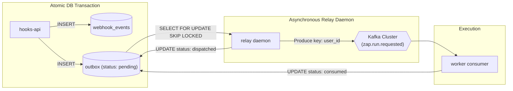

# Chapter 5 — The Transactional Outbox Pattern & Relay Daemon

> **ZapFlow Builder's Manual & Architecture Journey**  
> *Chapter 5 of 10*

---

## 5.1 The Dual-Write Dilemma in Distributed Architectures

When building an event-driven system, software engineers face a notorious distributed systems challenge known as **The Dual-Write Problem**.

Suppose our webhook ingest service needs to do two things upon receiving an event:
1. Save the incoming payload to the primary database (`PostgreSQL`).
2. Publish an execution event to the message broker (`Kafka`).

```
                              ┌──────────────────────┐
                              │  HTTP Webhook Handler│
                              └──────────┬───────────┘
                                         │
                   ┌─────────────────────┴─────────────────────┐
                   ▼                                           ▼
         Operation A: Database Write                 Operation B: Kafka Produce
         await db.events.insert(...)                 await kafka.send(...)
```

Because PostgreSQL and Apache Kafka are completely independent distributed systems, they cannot share a single database transaction. Two-Phase Commit (2PC) is notoriously complex, slow, and not supported by Kafka.

### The Inevitable Production Failures of Naive Dual-Writes:

#### Failure Scenario 1: Database First, Message Broker Second
```typescript
await db.events.insert(payload); // Step 1: Succeeds!
await kafka.send(event);          // Step 2: Fails! (Network blip or broker timeout)
```
- **Consequence:** The database holds the record, but Kafka never received the message. The Zap run is lost forever. It will never execute.

#### Failure Scenario 2: Message Broker First, Database Second
```typescript
await kafka.send(event);          // Step 1: Succeeds!
await db.events.insert(payload); // Step 2: Fails! (Deadlock, disk full, or crash)
```
- **Consequence:** Kafka broadcasts the message. The downstream worker receives it, queries the database for event details, finds nothing, and crashes with an unhandled `EntityNotFound` error!

---

## 5.2 The Transactional Outbox Pattern

To eliminate dual-write inconsistencies, ZapFlow implements the **Transactional Outbox Pattern**:



### The Invariant:
1. When `hooks-api` writes an incoming event to PostgreSQL, it simultaneously writes an entry into the `outbox` table **inside the exact same ACID transaction**.
2. If the transaction commits, both rows are guaranteed to exist. If it rolls back, neither exists.
3. A separate background daemon—`relay`—is tasked with safely reading pending rows from the outbox table and transmitting them to Kafka.

---

## 5.3 Deep Dive into the Relay Daemon (`apps/relay`)

The `relay` service is a standalone Node.js process running on **Port 3003** (health checks only). It contains no user-facing HTTP routes; its sole purpose is running the outbox polling loop.

### 5.3.1 Concurrency Without Contention: `FOR UPDATE SKIP LOCKED`

If multiple instances of `relay` run simultaneously in production (for high availability), how do they avoid claiming and publishing the exact same outbox rows?

In `apps/relay/src/poller/outbox-poller.ts`:

```typescript
const claimedRows = await prisma.$transaction(async (tx) => {
  const rows = await tx.$queryRaw<OutboxRow[]>`
    SELECT
      o.id,
      o.webhook_event_id AS "webhookEventId",
      o.event_id AS "eventId",
      o.payload,
      o.attempts,
      o.max_attempts AS "maxAttempts",
      we.zap_id AS "zapId",
      z.user_id AS "userId"
    FROM outbox o
    JOIN webhook_events we ON we.id = o.webhook_event_id
    JOIN zaps z ON z.id = we.zap_id
    WHERE o.status = 'pending'
    ORDER BY o.created_at ASC
    LIMIT ${env.RELAY_BATCH_SIZE}
    FOR UPDATE OF o SKIP LOCKED
  `;

  if (rows.length === 0) return [];

  // Optimistically mark as dispatched inside the transaction
  const ids = rows.map((r) => r.id);
  await tx.$executeRaw`
    UPDATE outbox
    SET status = 'dispatched', attempts = attempts + 1
    WHERE id = ANY(${ids}::bigint[])
  `;

  return rows;
});
```

### Why `FOR UPDATE SKIP LOCKED` is a Masterclass in Database Concurrency:
1. **Row-Level Locking:** Standard `FOR UPDATE` forces competing transactions to wait until the first transaction finishes, causing lock queues and database thread contention.
2. **`SKIP LOCKED`:** Instructs PostgreSQL: *"If another worker holds a lock on row $R$, do not wait for it—simply skip row $R$ and return the next unlocked rows."*
3. **Zero Coordination Overhead:** Ten `relay` instances can run concurrently without Redis distributed locks, ZooKeeper coordinators, or inter-process communication. PostgreSQL’s internal lock manager coordinates them automatically with zero deadlocks.

---

## 5.4 The Optimistic Claim Pattern

Notice the sequencing in the poller:
1. Inside the PostgreSQL transaction, the rows are marked `status = 'dispatched'` and `attempts = attempts + 1`.
2. The transaction is **committed**.
3. *Only then* does `relay` transmit messages to Kafka:

```typescript
// Produce to Kafka OUTSIDE the transaction
await Promise.allSettled(claimedRows.map((row) => produceRow(row)));
```

### Why Produce to Kafka Outside the Database Transaction?
Holding an open database transaction while performing network I/O over Kafka is an anti-pattern. If Kafka takes 2 seconds to respond, the database connection is held hostage, consuming a connection from the pool.

### What Happens if Kafka Fails? (Rollback Logic)
In `produceRow(row)`:

```typescript
try {
  await producer.send({
    topic: env.KAFKA_TOPIC_ZAP_RUN_REQUESTED,
    messages: [{
      key: row.userId.toString(),
      value: JSON.stringify(event),
    }],
  });
  logger.info({ outboxRowId: row.id.toString() }, '[relay] Dispatched outbox row');
} catch (err) {
  logger.error({ err, outboxRowId: row.id.toString() }, '[relay] Failed to produce to Kafka');

  const newAttempts = row.attempts + 1;
  if (newAttempts >= row.maxAttempts) {
    // Transition to dead letter state after 10 failed attempts
    await prisma.outbox.update({
      where: { id: row.id },
      data: { status: 'dead', attempts: newAttempts },
    });
  } else {
    // Revert status back to 'pending' so next sweep retries
    await prisma.outbox.update({
      where: { id: row.id },
      data: { status: 'pending', attempts: newAttempts },
    });
  }
}
```

If Kafka encounters a broker disconnect or network timeout:
- If `attempts < 10`: The row is set back to `'pending'`. The next poller sweep picks it up automatically.
- If `attempts >= 10`: The row is moved to `'dead'`. This alerts operators that an unrecoverable payload requires manual inspection, preventing poison-pill messages from blocking the outbox indefinitely.

---

## 5.5 Tenant Blast Radius Isolation via Partition Keys

When `relay` calls `producer.send(...)`, how does it choose the message key?

```typescript
messages: [
  {
    // Partition key = user_id — bounds blast radius per tenant
    key: row.userId.toString(),
    value: JSON.stringify(event),
  },
]
```

### Why Setting `key: row.userId` is Critical:

In Apache Kafka, messages with the same partition key are guaranteed to land on the **exact same partition**:

$$\text{Partition} = \text{hash}(\text{key}) \pmod{N_{\text{partitions}}}$$

```
Kafka Topic: zap.run.requested (e.g. 4 Partitions)
┌──────────────┐     ┌──────────────┐     ┌──────────────┐     ┌──────────────┐
│ Partition 0  │     │ Partition 1  │     │ Partition 2  │     │ Partition 3  │
│  User 101    │     │  User 102    │     │  User 103    │     │  User 104    │
│  (Normal)    │     │  (Flash Sale)│     │  (Normal)    │     │  (Normal)    │
│  Latency:    │     │  10,000 msgs │     │  Latency:    │     │  Latency:    │
│  < 10ms      │     │  Backlogged  │     │  < 10ms      │     │  < 10ms      │
└──────────────┘     └──────────────┘     └──────────────┘     └──────────────┘
```

1. **Strict FIFO Ordering per Tenant:**  
   If User 101 triggers Event A followed by Event B, both events land in Partition 0 in exact chronological order.
2. **Blast Radius Containment:**  
   If User 102 experiences an enormous traffic surge (e.g., 50,000 Shopify orders in 5 minutes), all 50,000 events are assigned to Partition 1.  
   - Workers consuming Partition 1 work through User 102's backlog.
   - Workers consuming Partitions 0, 2, and 3 continue executing events for Users 101, 103, and 104 with **sub-second latency**!
   A noisy neighbor can never exhaust the processing capacity of other tenants.

---

## 5.6 Graceful Shutdown Lifecycle

In cloud environments (Kubernetes, Railway, Render), containers receive `SIGTERM` signals when deploying updates. If a relay process abruptly terminates while reading an outbox batch, rows can become stuck in `'dispatched'` state.

In `apps/relay/src/main.ts`:

```typescript
let currentPollPromise: Promise<void> | null = null;

process.on('SIGTERM', async () => {
  logger.info('[relay] SIGTERM received — finishing in-flight poll before exit');
  requestStop(); // Sets stopRequested = true, breaking poller while loop

  if (currentPollPromise) {
    await currentPollPromise; // Await completion of current in-flight batch
  }

  await disconnectProducer(); // Cleanly flush Kafka buffers & disconnect
  await prisma.$disconnect();   // Drain database pool
  logger.info('[relay] Shutdown complete');
  process.exit(0);
});
```

The process signals the poller to stop accepting new work, waits for the current in-flight batch of Kafka messages to be acknowledged, flushes all producer buffers, and disconnects gracefully.

In Chapter 6, we analyze how the `worker` consumer processes these events and drives the sequential execution engine.
