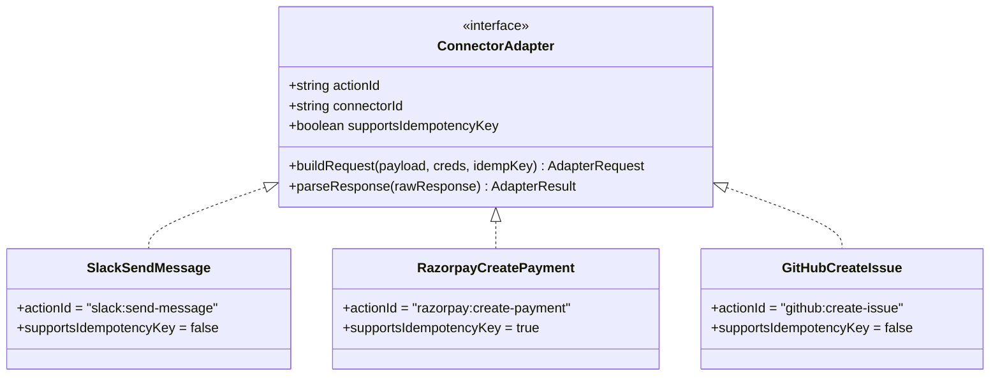

# Chapter 9 — The Connector Catalog & Extensibility Engine

> **ZapFlow Builder's Manual & Architecture Journey**  
> *Chapter 9 of 10*

---

## 9.1 The Unified Connector Adapter Pattern

In a workflow automation engine, third-party APIs have drastically different authentication schemes, URL structures, error formats, and idempotency guarantees:
- **Slack** uses OAuth 2.0 and returns errors inside `HTTP 200` JSON bodies (`{ ok: false, error: "channel_not_found" }`).
- **Razorpay** uses HTTP Basic Auth (`key_id:key_secret`) and natively supports `X-Idempotency-Key`.
- **GitHub** uses Personal Access Tokens (PAT) and structures errors according to GitHub REST API v3 specifications.

To prevent the core worker engine from becoming polluted with provider-specific `if/else` logic, ZapFlow enforces a unified contract: the **`ConnectorAdapter`** interface (`apps/worker/src/connectors/registry.ts`).

```typescript
export interface AdapterRequest {
  url: string;
  method: 'GET' | 'POST' | 'PUT' | 'PATCH' | 'DELETE';
  headers: Record<string, string>;
  body?: Record<string, unknown>;
}

export interface AdapterResult {
  status: 'completed' | 'failed' | 'ambiguous';
  output?: Record<string, unknown>;
  errorCode?: string;
  errorMessage?: string;
}

export interface ConnectorAdapter {
  actionId: string;
  connectorId: string;
  supportsIdempotencyKey: boolean;
  buildRequest(
    mappedPayload: Record<string, unknown>,
    credentials: Credentials,
    idempotencyKey: string,
  ): AdapterRequest;
  parseResponse(rawResponse: unknown): AdapterResult;
}
```



---

## 9.2 Adapter Case Studies

### 9.2.1 Case Study 1: Slack Send Message (`slack/actions/send-message.ts`)

```typescript
export const slackSendMessageAdapter: ConnectorAdapter = {
  actionId: 'slack:send-message',
  connectorId: 'slack',
  supportsIdempotencyKey: false,

  buildRequest(mappedPayload, credentials, _idempotencyKey) {
    if (credentials.type !== 'oauth') {
      throw new Error('Slack requires OAuth credentials');
    }

    return {
      url: 'https://slack.com/api/chat.postMessage',
      method: 'POST',
      headers: {
        Authorization: `Bearer ${credentials.accessToken}`,
        'Content-Type': 'application/json',
      },
      body: {
        channel: mappedPayload['channel'] as string,
        text: mappedPayload['text'] as string,
      },
    };
  },

  parseResponse(rawResponse) {
    const data = rawResponse as { ok: boolean; ts?: string; channel?: string; error?: string };

    if (data.ok) {
      return {
        status: 'completed',
        output: { ok: data.ok, ts: data.ts, channel: data.channel },
      };
    }

    return {
      status: 'failed',
      errorCode: 'SLACK_API_ERROR',
      errorMessage: data.error ?? 'Unknown Slack error',
    };
  },
};
```

#### Key Implementation Insights:
1. **The False 200 Problem:** Slack's API returns `HTTP 200 OK` even when errors occur (e.g., invalid channel name or insufficient bot permissions). If Axios only checked HTTP status codes, failing requests would be erroneously marked as `completed`. `parseResponse` inspects the internal `data.ok` boolean to detect API-level failures.
2. **Idempotency Unsupported:** Slack provides no header to prevent duplicate messages if a network request times out. Thus, `supportsIdempotencyKey = false`.

---

### 9.2.2 Case Study 2: Razorpay Create Payment Link (`razorpay/actions/create-payment.ts`)

```typescript
export const razorpayCreatePaymentAdapter: ConnectorAdapter = {
  actionId: 'razorpay:create-payment',
  connectorId: 'razorpay',
  supportsIdempotencyKey: true,

  buildRequest(mappedPayload, credentials, idempotencyKey) {
    if (credentials.type !== 'api_key') {
      throw new Error('Razorpay requires API key credentials');
    }

    // HTTP Basic Auth: key_id:key_secret encoded in base64
    const basicAuth = Buffer.from(
      `${credentials.apiKey}:${credentials.apiSecret ?? ''}`,
    ).toString('base64');

    return {
      url: 'https://api.razorpay.com/v1/payment_links',
      method: 'POST',
      headers: {
        Authorization: `Basic ${basicAuth}`,
        'Content-Type': 'application/json',
        'X-Idempotency-Key': idempotencyKey,
      },
      body: {
        amount: mappedPayload['amount'] as number,
        currency: mappedPayload['currency'] as string,
        description: (mappedPayload['description'] as string) ?? '',
      },
    };
  },

  parseResponse(rawResponse) {
    const data = rawResponse as { id?: string; short_url?: string; error?: { code?: string; description?: string } };

    if (data.error) {
      return {
        status: 'failed',
        errorCode: data.error.code ?? 'RAZORPAY_ERROR',
        errorMessage: data.error.description ?? 'Unknown Razorpay error',
      };
    }

    return {
      status: 'completed',
      output: { payment_link_id: data.id, url: data.short_url },
    };
  },
};
```

#### Key Implementation Insights:
1. **Idempotency Pass-Through:** Passes PostgreSQL's generated `idempotency_key` directly into Razorpay's `X-Idempotency-Key` header. If a network blip occurs and the worker re-transmits the request, Razorpay's server recognizes the key and returns the previously generated payment link without creating a duplicate charge.
2. **Composite Secret Handling:** Razorpay requires both a `key_id` and a `key_secret`, combined into an HTTP `Basic` authorization token.

---

### 9.2.3 Case Study 3: GitHub Create Issue (`github/actions/create-issue.ts`)

```typescript
export const githubCreateIssueAdapter: ConnectorAdapter = {
  actionId: 'github:create-issue',
  connectorId: 'github',
  supportsIdempotencyKey: false,

  buildRequest(mappedPayload, credentials, _idempotencyKey) {
    if (credentials.type !== 'api_key' || !credentials.apiKey) {
      throw new Error('GitHub requires a Personal Access Token (API Key)');
    }

    const owner = mappedPayload['owner'] as string;
    const repo = mappedPayload['repo'] as string;

    return {
      url: `https://api.github.com/repos/${owner}/${repo}/issues`,
      method: 'POST',
      headers: {
        Authorization: `Bearer ${credentials.apiKey}`,
        'Content-Type': 'application/json',
        'Accept': 'application/vnd.github.v3+json',
        'User-Agent': 'Zapier-Clone-Worker',
      },
      body: {
        title: mappedPayload['title'] as string,
        body: mappedPayload['body'] as string,
      },
    };
  },

  parseResponse(rawResponse) {
    const data = rawResponse as { id?: number; number?: number; html_url?: string };
    if (data.html_url && data.number) {
      return {
        status: 'completed',
        output: { issue_number: data.number, issue_url: data.html_url },
      };
    }
    return { status: 'failed', errorCode: 'GITHUB_API_ERROR' };
  },
};
```

#### Key Implementation Insights:
1. **Dynamic Path Templating:** Extracts `owner` and `repo` from the mapped payload to construct the dynamic REST endpoint URL:
   `https://api.github.com/repos/${owner}/${repo}/issues`
2. **Mandatory User-Agent:** GitHub rejects all API requests lacking a `User-Agent` header with `HTTP 403 Forbidden`. The adapter guarantees this header is always present.

---

## 9.3 The 4-Step Recipe for Adding a New Connector

Thanks to the adapter registry architecture (`apps/worker/src/connectors/registry.ts`), adding a new third-party integration (e.g., Discord or Notion) takes four clean steps:

### Step 1: Seed the Catalog in Database
In `packages/db/seed.js`, upsert the connector and action definitions:
```javascript
await prisma.connector.upsert({
  where: { id: 'discord' },
  create: {
    id: 'discord',
    name: 'Discord',
    authType: 'api_key', // Bot token
    scopes: ['bot'],
  },
});

await prisma.availableAction.upsert({
  where: { id: 'discord:send-channel-message' },
  create: {
    id: 'discord:send-channel-message',
    connectorId: 'discord',
    name: 'Send Channel Message',
    inputSchema: {
      type: 'object',
      required: ['channelId', 'content'],
      properties: {
        channelId: { type: 'string', title: 'Channel ID' },
        content: { type: 'string', title: 'Message Content' },
      },
    },
  },
});
```

### Step 2: Implement the `ConnectorAdapter` File
Create `apps/worker/src/connectors/discord/actions/send-message.ts` implementing `buildRequest` and `parseResponse`.

### Step 3: Register in the Adapter Map
In `apps/worker/src/connectors/registry.ts`:
```typescript
import { discordSendMessageAdapter } from './discord/actions/send-message';
registerAdapter(discordSendMessageAdapter);
```

### Step 4: Add Unit Tests
Create unit tests verifying that `buildRequest` formats headers correctly and `parseResponse` handles error payloads accurately.

The worker engine automatically resolves the new adapter by action ID!

In Chapter 10, we provide a complete, comprehensive file-by-file code walkthrough and operation index for the entire codebase.
