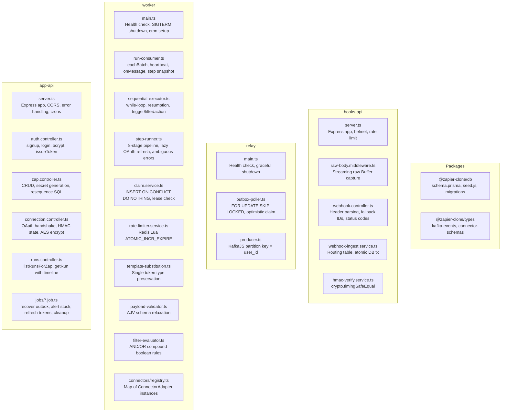

# Chapter 10 — Comprehensive Code Walkthrough & Reference Map

> **ZapFlow Builder's Manual & Architecture Journey**  
> *Chapter 10 of 10*

---

## 10.1 The Architecture Mind Map: File-to-Function Responsibility Grid

This chapter provides an exhaustive, function-by-function reference map for every service and package in the ZapFlow monorepo.



---

## 10.2 Service 1: `apps/hooks-api` (Port 3002)

### `server.ts`
- **Responsibility:** Ingress entry point. Bootstraps Helmet, IP rate-limiting, and mounts the webhook router.
- **Why it exists:** Isolates the high-volume public webhook receiver from the heavier management API.
- **Key Operations:**
  - `trust proxy, 1`: Allows `express-rate-limit` to read the real client IP from `X-Forwarded-For` behind Nginx/load balancers.
  - `webhookLimiter`: Enforces 300 requests/minute per IP window.
  - **No `express.json()`:** Intentionally absent. JSON parsing happens *after* raw HMAC verification.
- **Health Check:** `GET /health` executes `SELECT 1` against PostgreSQL. Returns HTTP 200/503.

### `middleware/raw-body.middleware.ts`
- **Function:** `rawBodyMiddleware(req, res, next)`
- **Inputs:** Express `Request` object.
- **Outputs:** Attaches `(req as RawRequest).rawBody: Buffer`.
- **Errors Handled:** If streamed byte count exceeds 5MB (`MAX_BODY_BYTES`), aborts connection (`req.destroy()`) and returns `HTTP 413 Payload Too Large`.
- **Why it exists:** HMAC-SHA256 signature calculation requires the exact raw byte stream as transmitted over TCP. Parsing JSON beforehand destroys byte sequence authenticity.

### `controllers/webhook.controller.ts`
- **Function:** `handleWebhook(req, res)`
- **Inputs:** `req.params` (`zapId`, `stepId`), headers (`x-hub-signature-256`, `x-razorpay-signature`, `x-webhook-signature`, `x-github-delivery`, `x-razorpay-event-id`, `x-webhook-id`, `x-github-event`), `req.rawBody`.
- **Outputs:** JSON acknowledgment with status codes:
  - `unauthorized`: Returns `HTTP 401 Invalid webhook signature`.
  - `not_found`: Returns `HTTP 200 {"received": true}` (silent concealment to prevent endpoint enumeration).
  - `ingested` / `duplicate` / `skipped`: Returns `HTTP 200 {"received": true}`.
  - `error`: Returns `HTTP 500` so upstream provider's retry mechanism engages.
- **Why it exists:** Extracts multi-provider headers with fallback priority, guards against invalid numeric IDs, and maps service ingest results to HTTP wire responses.

### `services/hmac-verify.service.ts`
- **Function:** `verifyWebhook(rawBody: Buffer, receivedSignature: string, secret: string): boolean`
- **Logic:**
  1. Computes `crypto.createHmac('sha256', secret).update(rawBody).digest('hex')`.
  2. Strips `sha256=` prefix if present (GitHub format).
  3. Checks `computedBuf.length === receivedBuf.length` to prevent `crypto.timingSafeEqual` range exceptions.
  4. Executes `crypto.timingSafeEqual(computedBuf, receivedBuf)`.
- **Why it exists:** Protects against side-channel timing attacks where string `===` comparison leaks secret characters based on response latency.

### `services/webhook-ingest.service.ts`
- **Function:** `ingestWebhook(zapId, stepId, rawBody, signature, eventId, githubEventType): Promise<IngestResult>`
- **Logic:**
  1. Queries PostgreSQL for active Zap and trigger step with `webhookSecret`.
  2. Verifies HMAC signature.
  3. Evaluates `matchesGitHubTrigger` against `GITHUB_TRIGGER_ROUTING`.
  4. Runs atomic transaction:
     - `INSERT INTO webhook_events (event_id, zap_id, payload) ... ON CONFLICT DO NOTHING`
     - `INSERT INTO zap_runs (zap_id, webhook_event_id, status) VALUES (..., 'queued')`
     - `INSERT INTO outbox (webhook_event_id, event_id, payload, status) VALUES (..., 'pending')`
- **Why it exists:** The central transactional boundary ensuring that accepted webhooks are atomically enqueued into the outbox.

---

## 10.3 Service 2: `apps/relay` (Port 3003)

### `main.ts`
- **Responsibility:** Relay lifecycle daemon and graceful shutdown coordinator.
- **Key Operations:**
  - Starts lightweight Express server on port 3003 for container health probes (`GET /health`).
  - Calls `pollOutbox()` to initiate the poller loop.
  - Handles `SIGTERM` / `SIGINT`: invokes `requestStop()`, awaits current batch completion (`await currentPollPromise`), closes Kafka producer, and disconnects Prisma.

### `kafka/producer.ts`
- **Functions:** `getProducer()`, `disconnectProducer()`
- **Configuration:** KafkaJS with `Partitioners.LegacyPartitioner`, SASL_SCRAM for Upstash/cloud Kafka, and automatic retries.

### `poller/outbox-poller.ts`
- **Function:** `pollOutbox(): Promise<void>`
- **Logic:** Runs a `while(!stopRequested)` loop:
  1. Executes `SELECT ... FROM outbox WHERE status = 'pending' ORDER BY created_at ASC LIMIT 50 FOR UPDATE OF o SKIP LOCKED`.
  2. Inside the SQL transaction, marks claimed rows as `status = 'dispatched'`, `attempts = attempts + 1`.
  3. Outside the SQL transaction, invokes `produceRow(row)` for each item via `Promise.allSettled`.
  4. Sleeps `RELAY_POLL_INTERVAL_MS = 2000` before the next iteration.
- **Function:** `produceRow(row: OutboxRow): Promise<void>`
  - Dispatches `ZapRunRequestedEvent` to Kafka topic `zap.run.requested` with `key: row.userId.toString()`.
  - On broker ACK: logs success.
  - On failure: reverts status to `'pending'` (if `attempts < maxAttempts`) or transitions to `'dead'` (if `attempts >= maxAttempts`).
- **Why it exists:** Guarantees at-least-once delivery from PostgreSQL to Kafka without distributed transactions.

---

## 10.4 Service 3: `apps/worker` (Port 3004)

### `main.ts`
- **Responsibility:** Worker daemon startup, health check server, and cron initialization.
- **Key Operations:**
  - Imports `./connectors/registry` to auto-register all third-party adapters at module load.
  - Starts Kafka consumer (`startConsumer()`).
  - Schedules `retryStuckSteps` cron job (`*/2 * * * *`).
  - Handles `SIGTERM`: pauses consumer, drains in-flight step for 5 seconds, disconnects Kafka, Redis, and Prisma.

### `consumer/run-consumer.ts`
- **Function:** `startConsumer(): Promise<void>`
  - Calls `connectWithRetry` (20 attempts with exponential backoff up to 30s) to handle Kafka startup latency in KRaft mode.
  - Configures `c.run({ eachBatch, autoCommit: false })`.
  - In each batch loop: parses event, executes `onMessage(event)`, resolves offset, and pulses `await heartbeat()`.
- **Function:** `onMessage(event: ZapRunRequestedEvent): Promise<void>`
  - Updates `zap_runs` setting `status = 'in_progress'` and serializes the immutable `step_snapshot` from `zap_steps`.
  - Updates `outbox` setting `status = 'consumed'`.
  - Verifies Zap is active and checks hourly rate cap via `underRunCap(zapId, maxRunsPerHour)`.
  - Passes run context into `resume()`.

### `engine/sequential-executor.ts`
- **Function:** `resume(zapRun, payloadContext): Promise<void>`
- **Logic:**
  1. Finds `maxCompletedPosition` from existing `zap_run_steps` with `status = 'completed'`.
  2. Iterates via `while(true)` starting at `currentPosition = maxCompletedPosition + 1`.
  3. If step is trigger: marks completed, aliases context to `step_1`, advances position.
  4. If step is filter: evaluates `evaluateFilter()`. If false, marks run `filtered` and halts.
  5. If step is action: executes `runStep()`.
     - On `completed`: merges output into `currentContext['step_' + (position + 1)]`, advances position.
     - On `processing` (rate-limited): exits loop gracefully (requeued).
     - On `ambiguous` or `failed`: marks run `failed` and halts.

### `engine/step-runner.ts`
- **Function:** `runStep(step, payloadContext, idempotencyKey, claimedRowId): Promise<StepRunResult>`
- **Logic:**
  1. Checks Redis rate limit via `checkAndConsume()`. If exceeded, calls `releaseWithDelay(claimedRowId)` and returns `'processing'`.
  2. Substitutes mustache tokens via `substituteTemplates()`.
  3. Validates mapped payload with AJV via `validateMappedPayload()`.
  4. Retrieves and decrypts stored credentials via `getCredentials()`.
  5. Invokes adapter's `buildRequest()` and executes Axios call (30s timeout).
  6. On 401: lazily refreshes token via `refreshToken()`, retries once.
  7. On network timeout (`ECONNABORTED`, `ETIMEDOUT`) or 5xx: returns status `'ambiguous'`.

### `services/claim.service.ts`
- **Function:** `claim(zapRunId, zapStepId): Promise<ClaimedStep | null>`
  - Executes `INSERT INTO zap_run_steps ... ON CONFLICT DO NOTHING RETURNING ...`.
  - If row already exists: checks if `claimed_at` is older than `WORKER_LEASE_TIMEOUT_MS = 120000`. If expired, reclaims as `'ambiguous'` and halts the run.
- **Function:** `recordStepResult(claimedId, result): Promise<void>`
  - Writes output, error codes, and final status (`completed`, `failed`, `ambiguous`) to PostgreSQL.

### `services/rate-limiter.service.ts`
- **Function:** `checkAndConsume(connectionId, limit, windowSeconds): Promise<boolean>`
  - Executes Redis Lua script `ATOMIC_INCR_EXPIRE` against key `ratelimit:{connectionId}`.
- **Function:** `underRunCap(zapId, cap): Promise<boolean>`
  - Evaluates current hourly bucket `runcap:{zapId}:{hourBucket}` against `maxRunsPerHour`.

### `engine/template-substitution.ts`
- **Function:** `apply(configTemplate, payloadContext): { mappedPayload, unresolvedFields }`
- **Logic:** Preserves native data types (`number`, `boolean`) for exact single tokens (`"{{step_1.payload.amount}}"`); string-interpolates mixed tokens (`"Hello {{step_1.payload.name}}!"`). Unresolved fields evaluate to `null`.

### `engine/filter-evaluator.ts`
- **Function:** `evaluate(filterConfig, payloadContext): boolean`
- **Logic:** Evaluates condition array (`eq`, `neq`, `contains`, `gt`, `lt`, `gte`, `lte`, `exists`) using `AND` / `OR` logic. Coerces numbers and strings transparently for webhook payload flexibility.

### `engine/payload-validator.ts`
- **Function:** `validateMappedPayload(mappedPayload, inputSchema, unresolvedFields): ValidationResult`
- **Logic:** Dynamically relaxes AJV JSON Schema by removing unresolved fields from `required` and allowing `null` types, preventing missing optional fields from aborting workflows.

---

## 10.5 Service 4: `apps/app-api` (Port 3001)

### `server.ts`
- **Responsibility:** Central HTTP application server. Configures CORS (`WEB_APP_URL`), JSON body parser (1MB limit), request logging middleware, route handlers, error middleware, and initializes background cron schedules.

### `middleware/auth.middleware.ts`
- **Function:** `authMiddleware(req, res, next)`
- **Logic:** Extracts `Authorization: Bearer <token>`, verifies signature with `jwt.verify(token, JWT_SECRET)`, parses `sub` as `req.userId = BigInt(decoded.sub)`.

### `services/encryption.service.ts`
- **Function:** `encrypt(plaintext: string): string`
  - Generates 12-byte random IV, encrypts with `aes-256-gcm`, extracts 16-byte auth tag, returns base64 `[IV + Tag + Ciphertext]`.
- **Function:** `decrypt(encoded: string): string`
  - Slices IV, auth tag, and ciphertext; authenticates tag and decrypts ciphertext.

### `services/oauth.service.ts`
- **Function:** `buildAuthUrl(connectorId, userId): string`
  - Creates HMAC-SHA256 signed `state` query param (`userId.nonce.signature`) to prevent OAuth CSRF attacks.
- **Function:** `exchangeCodeForTokens(connectorId, code): Promise<OAuthTokens>`
  - Exchanges authorization code with provider's token endpoint and returns encrypted access and refresh tokens.
- **Function:** `refreshAccessToken(connectionId: bigint): Promise<void>`
  - Uses refresh token to acquire new access token and updates PostgreSQL.

### `controllers/zap.controller.ts`
- **Endpoints:**
  - `GET /zaps`: Lists all Zaps for authenticated user with step count.
  - `GET /zaps/:id`: Fetches Zap and steps ordered by position (omitting `webhookSecret`).
  - `POST /zaps`: Validates steps (`validateZapSteps`), asserts connection ownership (`assertConnectionOwnership`), creates Zap and steps in database, generates 32-byte webhook secret for trigger.
  - `PATCH /zaps/:id`: Updates name, `isActive`, or `maxRunsPerHour`.
  - `DELETE /zaps/:id`: Cascading delete of Zap, steps, and runs.
  - `POST /zaps/:id/steps`: Appends step, asserts connection ownership.
  - `PATCH /zaps/:id/steps/:stepId`: Updates step config or connection.
  - `DELETE /zaps/:id/steps/:stepId`: Deletes step and re-sequences remaining positions using atomic SQL `UPDATE ... FROM (VALUES ...)`.
  - `GET /zaps/:id/steps/:stepId/webhook-secret`: Authenticated endpoint that returns the trigger step's secret key.

### `controllers/runs.controller.ts`
- **Endpoints:**
  - `GET /runs/zap/:zapId`: Paginated run history (`page`, `limit`) with step counts and execution status.
  - `GET /runs/:runId`: Full diagnostic detail for a single run, including all executed steps, inputs, outputs, errors, and timestamps.

### `jobs/*.job.ts` (The 4 Cron Jobs)
- **`outbox-cleanup.job.ts`:** Daily prune of `consumed` outbox rows older than 7 days.
- **`recover-dispatched-outbox.job.ts`:** Every 10 min, resets outbox rows stuck in `dispatched` > 15 min to `pending`.
- **`refresh-expiring-tokens.job.ts`:** Every 15 min, proactively refreshes OAuth connections expiring within 30 min.
- **`stuck-outbox-alert.job.ts`:** Every 5 min, triggers Sentry alert if any outbox row is stuck in `dispatched` > 30 min.

---

## 10.6 Packages: `@zapier-clone/db` & `@zapier-clone/types`

### `@zapier-clone/db`
- **`prisma/schema.prisma`:** Declarative definitions for all 10 models across the 6 architecture layers.
- **`seed.js`:** Production-safe, pure JavaScript catalog seed script. Inserts connectors (`slack`, `razorpay`, `github`, `webhooks`), triggers, and action input schemas without requiring TypeScript at container runtime.
- **`migrations/0001_init.sql`:** Complete SQL migration defining table constraints, `pgcrypto` extensions, check constraints, foreign keys, and the partial unique index `one_trigger_per_zap`.

### `@zapier-clone/types`
- **`kafka-events/zap-run-requested.event.ts`:** Canonical TypeScript contract for messages published to `zap.run.requested`:
  ```typescript
  export interface ZapRunRequestedEvent {
    webhookEventId: string;
    zapId: string;
    userId: string;
    payload: Record<string, unknown>;
    receivedAt: string;
  }
  ```

---

## 10.7 End-to-End Testing Suite (`pipeline.e2e.test.ts`)

Located in `apps/worker/src/e2e/pipeline.e2e.test.ts`:
- **Verification Coverage:**
  1. Creates user via `POST /auth/signup`.
  2. Creates Zap with `webhooks:catch_hook` trigger and `razorpay:create-payment` action.
  3. Fetches trigger's `webhookSecret` via authenticated API.
  4. Signs custom payload using HMAC-SHA256.
  5. Dispatches HTTP `POST` to `hooks-api` (`http://localhost:3002/hooks/:zapId/:stepId`).
  6. Verifies `hooks-api` acknowledges in under 50ms with `HTTP 200`.
  7. Waits for `relay` to poll outbox and publish to Kafka.
  8. Waits for `worker` to consume event, claim step, execute adapter, and transition `zap_runs` to `completed`.
  9. Polls `app-api` (`GET /runs/zap/:zapId`) and asserts run status is `completed` with step output recorded.

This concludes the 10-chapter architectural manual for the ZapFlow engine.
